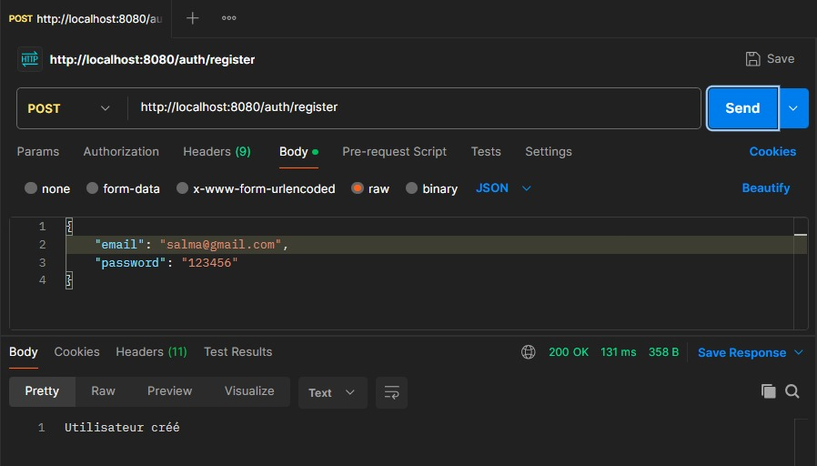
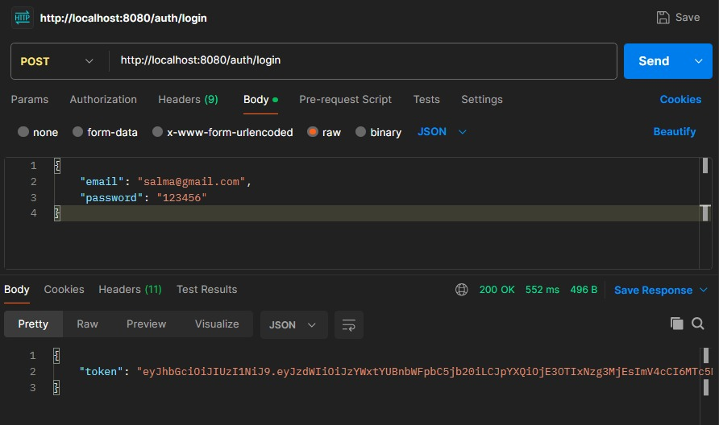
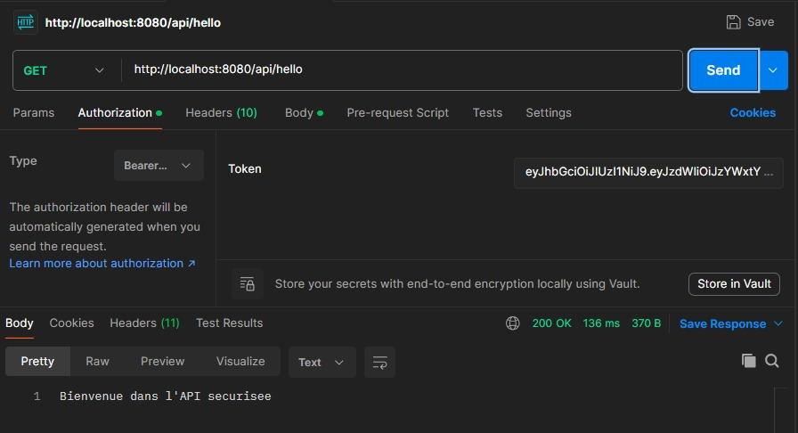
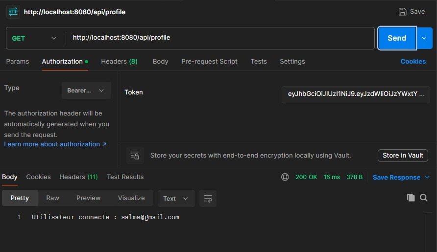
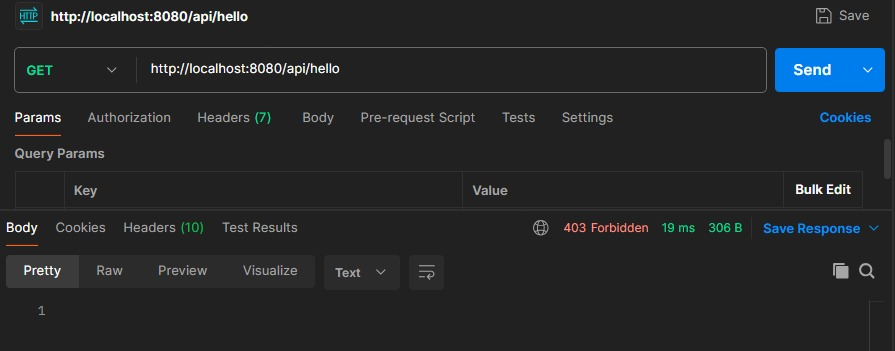
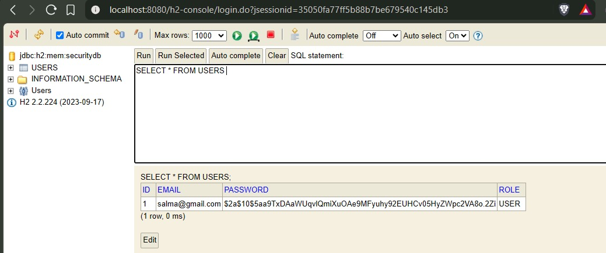

# TP 2: Authentification avec JWT et Spring Security

## Description

Ce projet est réalisé dans le cadre du module **Sécurité des applications**. Il met en place une authentification **JWT (JSON Web Token)** avec **Spring Boot** et **Spring Security**. L'application permet à un utilisateur de s'inscrire, de se connecter, et d'accéder à des ressources protégées à l'aide d'un token signé.

---

## Informations

- **Réalisé par** : Majri Salma
- **Établissement** : ENSET
- **Encadré par** : Pr. Abdelmajid BOUSSELHAM
- **Année universitaire** : 2025–2026

---

## Technologies utilisées

| Technologie | Version |
|---|---|
| Java | 17 |
| Spring Boot | 3.3.5 |
| Spring Security | 6.x |
| Spring Data JPA | 3.x |
| JJWT (Java JWT) | 0.12.6 |
| Lombok | 1.18.34 |
| H2 Database | 2.2.224 |
| Maven | — |
| Postman | — |

---

## Architecture du projet

```text
jwt-spring-app/
├── src/
│   ├── main/
│   │   ├── java/ma/majrisalma/jwtspringapp/
│   │   │   ├── config/
│   │   │   │   └── SecurityConfig.java
│   │   │   ├── controllers/
│   │   │   │   ├── AuthController.java
│   │   │   │   └── UserController.java
│   │   │   ├── dto/
│   │   │   │   ├── AuthResponse.java
│   │   │   │   ├── LoginRequest.java
│   │   │   │   └── RegisterRequest.java
│   │   │   ├── entity/
│   │   │   │   └── AppUser.java
│   │   │   ├── repository/
│   │   │   │   └── UserRepository.java
│   │   │   ├── security/
│   │   │   │   └── JwtFilter.java
│   │   │   ├── service/
│   │   │   │   ├── CustomerUserDetailsService.java
│   │   │   │   └── JwtService.java
│   │   │   └── JwtSpringAppApplication.java
│   │   └── resources/
│   │       └── application.properties
│   └── test/
├── screenshots/
│   ├── 1.png
│   ├── 2.png
│   ├── 3.png
│   ├── 4.png
│   ├── 5.png
│   └── 6.png
└── pom.xml
```

---

## Configuration (`application.properties`)

```properties
spring.application.name=jwt-spring-app

# Base de données H2 en mémoire
spring.datasource.url=jdbc:h2:mem:securitydb
spring.datasource.driverClassName=org.h2.Driver
spring.datasource.username=sa
spring.datasource.password=

# JPA / Hibernate
spring.jpa.hibernate.ddl-auto=update
spring.jpa.show-sql=true

# Console H2
spring.h2.console.enabled=true
spring.h2.console.path=/h2-console

# JWT
jwt.secret=V6hpcy1pcy1hLXZlcNktbG9uZ3ZWM2VhWmc1cWQ3QtlZGtby0yMDI2
jwt.expiration=3600000
```

## Lancement du projet

### Cloner le projet

```bash
git clone https://github.com/Salma-Majri/TP2_JWT_Spring_App.git
cd jwt-spring-app
```

### Compiler et lancer avec Maven

```bash
mvn clean install
mvn spring-boot:run
```

Ou lancer directement depuis IntelliJ IDEA : exécuter `JwtSpringAppApplication`.

L'application démarre sur http://localhost:8080.

---


##  Tests avec Postman

###  Étape 1 : Inscription (Register)

**Méthode :** POST

**URL :** `http://localhost:8080/auth/register`

**Body → raw → JSON :**

```json
{
    "email": "salma@test.com",
    "password": "123456"
}
```

**Réponse attendue :** `200 OK` — Utilisateur créé.



###  Étape 2 : Connexion (Login)

**Méthode :** POST

**URL :** `http://localhost:8080/auth/login`

**Body → raw → JSON :**

```json
{
    "email": "salma@test.com",
    "password": "123456"
}
```

**Réponse attendue :** `200 OK` avec un token JWT :

```json
{
    "token": "eyJhbGciOiJIUzI1NiJ9..."
}
```



### Étape 3 : Accès à `/api/hello` (avec token)

**Méthode :** GET

**URL :** `http://localhost:8080/api/hello`

**Headers :**

| Key | Value |
|---|---|
| Authorization | `Bearer <votre_token>` |

**Réponse attendue :** `200 OK` — Bienvenue dans l'API securisee.



### Étape 4 : Accès à `/api/profile` (avec token)

**Méthode :** GET

**URL :** `http://localhost:8080/api/profile`

**Headers :**

| Key | Value |
|---|---|
| Authorization | `Bearer <votre_token>` |

**Réponse attendue :** `200 OK` — Utilisateur connecte : salma@test.com.



### Étape 5 : Accès sans token (accès refusé)

**Méthode :** GET

**URL :** `http://localhost:8080/api/hello`

**Headers :** aucun.

**Réponse attendue :** `403 Forbidden`.



###  Étape 6 : Console H2

**URL :** http://localhost:8080/h2-console

**JDBC URL :** `jdbc:h2:mem:securitydb`

**User Name :** `sa`

**Password :** (vide)

Exécuter la requête SQL suivante pour voir les utilisateurs :

```sql
SELECT * FROM users;
```



---

##  Fonctionnement du JWT

1. L'utilisateur s'inscrit via `/auth/register` : le mot de passe est chiffré avec BCrypt avant stockage.
2. Lors de la connexion via `/auth/login`, l'`AuthenticationManager` vérifie les identifiants.
3. Un token JWT est généré avec les informations suivantes :
   - **Subject :** e-mail de l'utilisateur.
   - **IssuedAt :** date d'émission.
   - **Expiration :** 1 heure.
   - **Signature :** HMAC-SHA256 avec la clé secrète.
4. Le client envoie ce token dans l'en-tête `Authorization: Bearer <token>` à chaque requête protégée.
5. Le `JwtFilter` intercepte la requête, valide le token et authentifie l'utilisateur dans le `SecurityContext`.

---

##  Description des composants principaux

### `AppUser`

Entité JPA représentant un utilisateur avec `id`, `email` (unique), `password` et `role`.

### `UserRepository`

Interface JPA avec les méthodes `findByEmail()` et `existsByEmail()`.

### `JwtService`

Service qui gère la génération, l'extraction et la validation du token JWT.

### `CustomerUserDetailsService`

Implémentation de `UserDetailsService` qui charge l'utilisateur par e-mail.

### `JwtFilter`

Filtre `OncePerRequestFilter` qui intercepte les requêtes HTTP, extrait le token, le valide et place l'utilisateur dans le `SecurityContext`.

### `SecurityConfig`

Configuration de Spring Security : désactivation du CSRF, session stateless, `permitAll` sur `/auth/**` et `/h2-console/**`, ajout du `JwtFilter`.

### `AuthController`

Contrôleur REST exposant les endpoints `/auth/register` et `/auth/login`.

### `UserController`

Contrôleur REST exposant les endpoints protégés `/api/hello` et `/api/profile`.

---

##  Conclusion

Ce TP a permis de mettre en place une authentification stateless basée sur JWT avec Spring Boot et Spring Security. L'application gère l'inscription, la connexion, la génération et la validation des tokens, ainsi que la protection des ressources sensibles.

Les tests effectués avec Postman confirment le bon fonctionnement de l'ensemble de la chaîne d'authentification.
